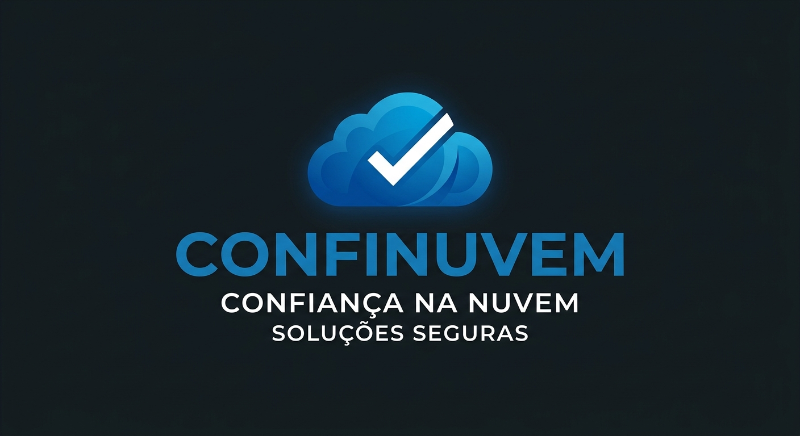

__PLANO DE NEGÓCIOS__

__CONFINUVEM__

__EQUIPE:__

João Augusto Silva de Araújo

Miguel Rodrigo da Silva Normando

Pedro Henrique de Sousa Dantas Gomes

Wesley Trajano Cardoso do Carmo

__OUTUBRO/2026__

__SEÇÃO 3 - PLANO DE MARKETING__



*Logomarca: nuvem azul com símbolo de verificação (segurança e confiança) e o nome ConfiNuvem em tipografia sólida, sobre fundo escuro.*

# Plano de Marketing — ConfiNuvem

__Equipe:__ João Augusto Silva de Araújo, Miguel Rodrigo da Silva Normando, Pedro Henrique de Sousa Dantas Gomes e Wesley Trajano Cardoso do Carmo.

Outubro/2026 · Seção 3 do Plano de Negócios

*Os valores de pró-labore, marketing, custo variável, lucro e investimentos são estimativas da equipe para este plano.*

## 3.1 Logomarca e slogan

### 3.1.1 Nome da marca

O nome da marca é __ConfiNuvem__. Ele funde *"Confiança"* (confiabilidade, sigilo e segurança da informação) e *"Nuvem"* (computação em nuvem e modernização digital), comunicando de forma imediata a proposta de valor da empresa ao mercado de pequenas e médias empresas.

### 3.1.2 Valores da marca

1. __Segurança e proteção cibernética__ no tratamento de dados sensíveis.
2. __Confiabilidade__ contra perda de arquivos físicos.
3. __Modernização tecnológica simplificada__ para empresas sem equipe própria de TI.
4. __Educação e autonomia__ por meio da capacitação dos funcionários do cliente.
5. __Parceria contínua__ no suporte pós-migração.

### 3.1.3 Definição de conceitos

__Conceito__

__Representação visual__

Confiança

azul, tipografia sólida

Segurança

símbolo de verificação (check) em branco

Nuvem (migração digital)

nuvem estilizada em tons de azul

Tecnologia

formas geométricas, tipografia moderna sem serifa

Simplicidade

traços limpos, fundo escuro e texto legível

\!\[Logomarca da ConfiNuvem\](imagens/logo-confinuvem.jpg)

Logomarca: nuvem azul com símbolo de verificação (segurança e confiança) e o nome ConfiNuvem em tipografia sólida, sobre fundo escuro.

### 3.1.4 Slogan

__"Confiança na nuvem"__

## 3.2 Descrição dos produtos/serviços

A ConfiNuvem oferece um __portfólio de serviços individualizados__ que podem ser contratados de forma avulsa ou combinados no __Pacote Integrado de Migração Segura e Modernização em Nuvem (Protocolo ConfiNuvem)__ com desconto. Cada serviço possui escopo, entregáveis, precificação e dependências próprias.

### 3.2.1 Catálogo de serviços

__#__

__Serviço__

__Nome comercial__

__Modelo de contratação__

__Dependência__

1

Avaliação de ambiente

**Diagnóstico ConfiNuvem**

Avulsa / Gratuita (ação comercial)

Nenhuma (entrada)

2

Planejamento de migração

**Plano de Migração ConfiNuvem**

Projeto (por hora)

Requer Avaliação

3

Execução da migração

**Migração ConfiNuvem**

Projeto (por hora)

Requer Planejamento

4

Capacitação de equipes

**Trilha ConfiNuvem**

Avulsa / Pacote (por hora)

Recomendada pós-Execução

5

Gestão contínua (Managed Services)

**ConfiNuvem Care**

**Mensal recorrente (faixas)**

Independente

***Nota:** O serviço de Gestão Contínua (ConfiNuvem Care) é detalhado na seção 3.6 com metodologia, faixas e preços próprios (MRR). Os serviços 1–4 seguem precificação por hora de serviços especializados (seção 3.3).*

### 3.2.2 Detalhamento dos serviços especializados (1–4)

#### 1. Diagnóstico ConfiNuvem (Avaliação)

- __Escopo:__ Análise de inventário de dados, volumetria, requisitos de segurança, conformidade LGPD, maturidade cloud e riscos.
- __Entregáveis:__ Relatório em PDF (10–15 páginas), mapa de calor de riscos, estimativa de esforço e custo para migração.
- __Duração típica:__ 4–8 horas.
- __Precificação:__ Gratuita como ação de geração de leads (seção 3.5); avulsa a R$ 52,46/h se contratada isoladamente.

#### 2. Plano de Migração ConfiNuvem (Planejamento)

- __Escopo:__ Definição de arquitetura alvo (Google Cloud, AWS, Supabase, NeonDB), seleção de ferramentas de segurança e backup, cronograma detalhado (Gantt), TCO estimado, plano de rollback, matriz de riscos.
- __Entregáveis:__ Documento técnico (20–30 páginas), cronograma, orçamento detalhado, matriz de riscos.
- __Duração típica:__ 8–16 horas.
- __Precificação:__ R$ 52,46/hora (serviços especializados).
- __Requer:__ Diagnóstico prévio (pode ser fornecido pelo cliente ou contratado à parte).

#### 3. Migração ConfiNuvem (Execução)

- __Escopo:__ Provisionamento de infraestrutura, migração de bancos de dados e documentos, validação de integridade, cutover planejado, testes de aceitação.
- __Entregáveis:__ Ambiente em produção, relatório de migração, checklist de validação, credenciais e acessos documentados.
- __Duração típica:__ 20–80 horas (conforme volumetria e complexidade).
- __Precificação:__ R$ 52,46/hora (serviços especializados).
- __Requer:__ Plano de Migração aprovado.

#### 4. Trilha ConfiNuvem (Capacitação)

- __Escopo:__ Segurança da informação (senhas, phishing, LGPD), operação diária (backup, monitoramento, HashiCorp Vault), boas práticas de cloud.
- __Entregáveis:__ Sessões de treinamento (remoto ou presencial), material didático (PDF/vídeo), certificado de conclusão por participante.
- __Duração típica:__ 4–16 horas (conforme número de turmas e profundidade).
- __Precificação:__ R$ 52,46/hora (serviços especializados); pode ser incluída no pacote integrado.
- __Modalidades:__ Inclusa no pacote, avulsa para equipe do cliente, ou recorrente para novos colaboradores.

### 3.2.3 Pacote Integrado (Protocolo ConfiNuvem)

A contratação conjunta dos quatro serviços especializados (Avaliação \+ Planejamento \+ Execução \+ Capacitação) constitui o __Pacote Integrado__, com benefícios:

__Pacote__

__Composição__

__Desconto vs. avulso__

__Preço de referência*__

**Migração Completa**

Diagnóstico \+ Planejamento \+ Execução \+ Capacitação (≈36 h)

10%

~R$ 1.890

**Migração \+ Gestão 12 meses**

Migração Completa \+ ConfiNuvem Care Pro × 12 meses

15%

~R$ 25.890

\\* Baseado em hora de serviços especializados R$ 52,46 (seção 3.3.7) e preços do ConfiNuvem Care (seção 3.6.4). Valores arredondados; orçamento formal emitido após Diagnóstico.

### 3.2.4 Matriz de dependências

┌─────────────────┐  
│  DIAGNÓSTICO    │  ◄── Entrada (pode ser gratuito)  
│  (Avaliação)    │  
└────────┬────────┘  
         │  
         ▼  
┌─────────────────┐  
│  PLANEJAMENTO   │  ◄── Requer Avaliação  
│  (Plano Mig.)   │  
└────────┬────────┘  
         │  
         ▼  
┌─────────────────┐  
│   EXECUÇÃO      │  ◄── Requer Planejamento  
│   (Migração)    │  
└────────┬────────┘  
         │  
         ▼  
┌─────────────────┐     ┌──────────────────────┐  
│  CAPACITAÇÃO    │     │  GESTÃO CONTÍNUA     │  
│  (Trilha)       │     │  (ConfiNuvem Care)   │  
└─────────────────┘     └──────────────────────┘  
   (opcional,            (recorrente, independente  
    recomendada)           — pode vir sem migração)

### 3.2.5 Diferenciais frente aos concorrentes

- __Portfólio modular:__ Diferente de NeonDB e Supabase (que empacotam plataforma \+ migração opaca), a ConfiNuvem permite contratar apenas o necessário — do diagnóstico gratuito à gestão contínua.
- __Entregáveis formais por etapa:__ Cada serviço gera artefato tangível (relatório, plano, checklist, certificado), não apenas "execução".
- __Capacitação inclusa e avulsa:__ Treinamento com material didático e certificado, não apenas documentação.
- __Gestão contínua separada (ConfiNuvem Care):__ Serviço recorrente com SLA, faixas de preço e escopo claro (backup, Vault, monitoramento, suporte, compliance), alinhado ao modelo MSP de mercado.
- __Processo em 5 etapas com dependências explícitas:__ Transparência sobre o que cada fase exige e entrega.
- __Segurança:__ Ferramentas de backup (Acronis), criptografia/segredos (HashiCorp Vault), Google Cloud Migration Center no planejamento.
- __Fidelização:__ Descontos progressivos no pacote integrado e no ConfiNuvem Care conforme anos de contrato.

## 3.3 Estratégia de precificação

Diretriz __conservadora e de mínimo custo inicial__: operação 100% remota (home office), apenas com os 4 sócios, sem aluguel e sem funcionários CLT na fase inicial. Os sócios são remunerados por pró-labore.

### 3.3.1 Capacidade produtiva a 70%

Cada integrante dedica 6 horas diárias durante 20 dias úteis por mês (120 h mensais; 480 h no total).

Integrantes x horas x dias no mês x 0,7 = 4 x 6 x 20 x 0,7 = 336 horas produtivas/mês

### 3.3.2 Custos fixos mensais

__Item__

__Descrição__

__Valor__

Licenças de software

Google Cloud Migration Center (gratuito) \+ suíte básica colaborativa

R$ 150,00

Aluguel

Operação 100% remota, sem sede física inicial

R$ 0,00

Contabilidade

Assessoria contábil digital econômica (Simples Nacional)

R$ 200,00

Internet/telefone

Rateio de conectividade e linha comercial VoIP/WhatsApp

R$ 200,00

Luz

Rateio conservador de energia para operação remota (4 integrantes)

R$ 160,00

Material de escritório

Os integrantes já possuem o material necessário

R$ 0,00

Material de limpeza

Não se aplica (home office)

R$ 0,00

Outras despesas administrativas

Nenhuma na fase inicial

R$ 0,00

**Subtotal administrativas**

**R$ 710,00**

Pessoal (salários, FGTS, 13º, férias, indenização)

Não se aplica: sem CLT, sócios por pró-labore

R$ 0,00

Design

Assinatura de ferramenta de design (estimativa)

R$ 100,00

Imprensa

Divulgação 100% digital

R$ 0,00

Folders

Folder digital em PDF

R$ 0,00

Propaganda em internet

Anúncios em redes sociais e Google (ação comercial da seção 3.5)

R$ 300,00

**Subtotal marketing**

**R$ 400,00**

Pró-labore da direção

4 sócios x R$ 1.621,00 (base: salário mínimo de 2026; estimativa)

R$ 6.484,00

INSS sobre pró-labore (11%)

11% sobre o pró-labore

R$ 713,24

**Subtotal financeiras**

**R$ 7.197,24**

**Custo fixo total**

**R$ 8.307,24**

***Nota:** Este custo fixo total contempla apenas **Custos Fixos Compartilhados (FC)** — itens que não variam com o número de clientes (pró-labore, contabilidade, aluguel, licenças base da empresa, marketing fixo). Custos que escalam por cliente (Acronis por estação, Vault por cliente, monitoramento por faixa, infraestrutura cloud do cliente) são classificados como **Variáveis por Cliente (VC)** e tratados separadamente no custo variável unitário (R$ 12,00/h) ou nas faixas do ConfiNuvem Care (MRR). Ver metodologia completa na seção *Classificação de Custos das Ferramentas e Metodologia de Rateio* do plano de negócios.*

### 3.3.3 Custo fixo unitário

Custo fixo total / capacidade produtiva = R$ 8.307,24 / 336 h = R$ 24,72 por hora

### 3.3.4 Custo variável

Custos que crescem com o volume de projetos: infraestrutura de homologação e armazenamento temporário na nuvem durante a migração, e licenças de backup e segurança por cliente (Acronis, HashiCorp), cobradas por uso.

A conversão de custos em dólar (USD) para real (BRL) utiliza uma __cotação fixa de referência de R$ 5,40/USD__, definida em 21 set. 2026 como premissa de planejamento para eliminar volatilidade cambial nos cálculos (ver detalhes nas *Tabelas de Referência de Preços dos Fornecedores e Câmbio* do plano de negócios).

A __classificação e rateio dos custos das ferramentas__ segue a metodologia documentada no plano de negócios (seção *Classificação de Custos das Ferramentas e Metodologia de Rateio*), que distingue:

- __Custos Fixos Compartilhados (FC):__ Rateados no custo fixo unitário (R$ 24,72/h) — ex.: cluster Vault base, licenças internas.
- __Custos Variáveis por Cliente — Projeto (VC-P):__ Incluídos no custo variável unitário (R$ 12,00/h) — ex.: Acronis/Vault por cliente durante migração, infraestrutura temporária (PT).
- __Custos Variáveis por Cliente — Recorrente (VC-R):__ Base das faixas do ConfiNuvem Care (MRR) — ex.: Acronis/Vault/Monitoramento por faixa.
- __Custos Mistos (MX):__ Componente base no FC, componente por cliente no VC-R.

Esta separação evita dupla contabilização: custos fixos não entram no variável e vice-versa; custos de projeto (migração) não se confundem com custos recorrentes (Care).

Estimativa para um projeto de referência (pequena empresa, 40 horas de serviço): R$ 480,00 de infraestrutura e licenças (preços de fornecedores em USD convertidos à taxa fixa de R$ 5,40; detalhamento nas tabelas de referência do plano de negócios).

Custo variável unitário = R$ 480,00 / 40 h = R$ 12,00 por hora

***Nota:** O valor de R$ 12,00/h é conservador (≈50% do custo variável estimado bruto de ~R$ 24,00/h), proporcionando margem de segurança para variação de escopo e economia de escala em projetos maiores. Ver seção *Custos de Infraestrutura Cloud Estimados para Projeto de Referência* e *Classificação de Custos das Ferramentas e Metodologia de Rateio* no plano de negócios.*

### 3.3.5 Custo unitário total (CUT)

CUT = custo fixo unitário \+ custo variável unitário = R$ 24,72 \+ R$ 12,00 = R$ 36,72 por hora

### 3.3.6 Taxa de markup

__Componente__

__%__

Impostos

6

Cartão

4

Lucro (12–30%)

15

Investimentos (5–10%)

5

**Total**

**30**

Taxa de markup = 100 / (100 - 30) = 100 / 70 = 1,4286

### 3.3.7 Preço de venda da hora de serviço (básica)

CUT x taxa de markup = R$ 36,72 x 1,4286 = R$ 52,46 por hora

### 3.3.8 Precificação por serviço especializado

A hora de serviços especializados (R$ 52,46/h) é a base para os serviços 1–4 da seção 3.2.2. Estimativas de faixa de horas e investimento por serviço:

__Serviço__

__Faixa de horas típica__

__Investimento estimado (R$)__

**1. Diagnóstico ConfiNuvem**

4–8 h

Gratuito (ação comercial) / R$ 210–420 (avulso)

**2. Plano de Migração**

8–16 h

R$ 420–840

**3. Execução da Migração**

20–80 h

R$ 1.050–4.200

**4. Trilha ConfiNuvem (Capacitação)**

4–16 h

R$ 210–840

***Observação:** Valores são estimativas para planejamento. Orçamento formal emitido após Diagnóstico (serviço 1), considerando volumetria, complexidade, número de bancos/documentos e requisitos de segurança do cliente.*

***Serviço 5 (ConfiNuvem Care):** Precificação própria por faixas mensais (MRR), distinta dos serviços especializados por hora. Ver seção 3.6.*

## 3.4 Estratégia de distribuição

Distribuição __direta__. A ConfiNuvem presta o serviço sem intermediários, de forma remota: contato por site, redes sociais (LinkedIn e Instagram) e WhatsApp Business; diagnóstico e reuniões por videochamada; contrato assinado digitalmente. A distribuição indireta não será adotada na fase inicial, pois a margem prevista no markup não comporta comissão de revendedores.

## 3.5 Estratégia de promoção e publicidade em marketing digital

### Ação comercial: "Diagnóstico Gratuito \+ Indicação Premiada"

- __Objetivo:__ gerar contatos qualificados de pequenas empresas e converter o diagnóstico inicial em contrato. Contexto: 39% das micro, pequenas e médias empresas brasileiras ainda fazem controles financeiros de forma manual, em planilhas dispersas ou papel (CONTA SIMPLES; VISA, 2025 apud STARTUPS.COM.BR, 2025).
- __Promoção de vendas:__

1. diagnóstico gratuito do ambiente da empresa por videochamada (etapa de avaliação do Protocolo ConfiNuvem);
2. 10% de desconto no primeiro contrato para a empresa indicada por um cliente;
3. descontos progressivos na manutenção e no suporte conforme os anos de contrato.

- __Canais e peça:__ anúncios no Instagram, LinkedIn e Google, com verba de R$ 300,00 por mês (já prevista nos custos fixos), e divulgação por WhatsApp Business. Anúncio em post e vídeo curto: "Seus documentos ainda estão no papel? Faça um diagnóstico gratuito. ConfiNuvem: confiança na nuvem.", com botão de contato.
- __Indicadores:__ diagnósticos agendados, taxa de conversão do diagnóstico em contrato e custo por contato gerado.

### Ação social: "Dados Seguros, Negócio Protegido"

- __Objetivo:__ orientar microempreendedores, pequenos negócios e associações sobre segurança da informação e proteção de dados, fortalecendo a imagem da marca como parceira de confiança. Contexto: a ANPD passou a atuar como agência reguladora e ampliou a fiscalização da LGPD em 2026 (AUTORIDADE NACIONAL DE PROTEÇÃO DE DADOS, 2026).
- __Ações:__ oficinas online gratuitas e mensais sobre backup, senhas seguras, golpes digitais e noções de LGPD, em parceria com associações comerciais e instituições de ensino locais; série de posts educativos nas redes sociais com a hashtag #DadosSeguros, em linguagem simples.
- __Custo e resultado esperado:__ sem custo adicional de mídia, pois usa canais próprios e o tempo dos sócios. Espera-se ampliar o alcance orgânico, gerar contatos e posicionar a ConfiNuvem como referência em segurança de dados.

## 3.6 Metodologia de custos e precificação para o acesso mensal (ConfiNuvem Care)

Esta seção define a metodologia de cálculo separada para o serviço recorrente __ConfiNuvem Care__ (gestão contínua / Managed Services), serviço 5 do portfólio (seção 3.2). O modelo de custo unitário \+ markup por hora (seção 3.3) aplica-se aos __serviços de consultoria por projeto (serviços 1–4)__ e __não__ deve ser aplicado automaticamente ao serviço recorrente de acesso mensal, pois as naturezas de custo e entrega são distintas.

### 3.6.1 Escopo do serviço mensal (O que está incluído)

O __ConfiNuvem Care__ é a gestão proativa contínua do ambiente cloud do cliente, compreendendo:

__Componente__

__Descrição__

__Responsabilidade da ConfiNuvem__

**Backup gerenciado**

Configuração, monitoramento, testes de restore, retenção (Acronis Cyber Protect Cloud)

Operação completa; cliente não gerencia console

**Vault gerenciado**

Políticas de segredos, rotação automática, auditoria de acesso (HashiCorp Vault HCP)

Operação completa; cliente usa segredos, não administra Vault

**Monitoramento & SIEM**

Alertas de segurança, disponibilidade, performance; dashboards; correlação de logs

Configuração, ajuste de thresholds, resposta a alertas (N1/N2)

**Suporte N1/N2**

Atendimento via ticket/telefone, SLA de resposta/resolução, escalação

N1: triagem e resolução padrão; N2: especialistas; N3: encaminhamento a vendor

**Manutenção contínua**

Patches de SO/middleware, otimizações de custo/performance, hardening

Aplicação programada; janelas de manutenção acordadas

**Relatórios compliance LGPD**

Relatórios trimestrais de conformidade, evidências de backup/criptografia/acesso

Geração e entrega; apoio a auditorias do cliente

**Governança de custos**

Tagging, orçamentos, alertas de anomalia de gasto cloud (FinOps básico)

Configuração e relatório mensal de otimização

***Fora do escopo (não incluído no acesso mensal):***

*- Migração de novos sistemas/bancos (serviço 3 — projeto à parte)*

*- Capacitação de novas turmas (serviço 4 — projeto/hora à parte)*

*- Desenvolvimento de automações customizadas além do padrão*

*- Responsabilidade por decisões de arquitetura do cliente fora do ambiente gerenciado*

*- Custos de infraestrutura cloud do cliente (compute, storage, network) — faturados direto pelo provedor ou repassados sem markup*

### 3.6.2 Custos necessários para disponibilizar o serviço (Unidades de cobrança)

Os custos do ConfiNuvem Care são __exclusivamente Variáveis por Cliente — Recorrente (VC-R)__ e __Custos de Equipe Rateados (Suporte/Manutenção/Compliance)__. Não incluem Custos Fixos Compartilhados (FC) da empresa (pró-labore, aluguel, contabilidade, marketing fixo), que já são cobertos pela hora de serviços especializados (R$ 52,46/h).

__Categoria de Custo__

__Fornecedor / Origem__

__Unidade de Cobrança__

__Tipo__

__Base de Cálculo__

**Backup gerenciado**

Acronis Cyber Protect Cloud (MSP)

Por estação de trabalho / mês

VC-R (variável por cliente)

Qtd estações do cliente × US$ 7,08 × 5,40

**Vault gerenciado**

HashiCorp HCP — Cliente gerenciado

Por cliente / mês

VC-R (variável por cliente)

1 a N clientes × US$ 72,92 × 5,40

**Monitoramento / SIEM**

AWS CloudWatch / Google Cloud Monitoring \+ ferramentas SIEM

Por métrica/log/alertas / mês

VC-R (estimado por faixa)

Base por faixa (ver tabela 3.6.4)

**Suporte N1/N2 (equipe)**

Próprio — rateio de capacidade dos sócios

Horas/semana alocadas por faixa

Rateio de capacidade

Horas/semana × 4,33 semanas × R$ 52,46/h

**Manutenção / Patches**

Próprio — rateio de capacidade dos sócios

Incluído nas horas de suporte

Rateio de capacidade

Incluso nas horas acima

**Relatórios compliance LGPD**

Próprio — rateio de capacidade dos sócios

Trimestral (rateado mensalmente)

Rateio de capacidade

Incluso nas horas de suporte

**Infraestrutura cloud do cliente**

AWS / Google Cloud (compute, storage, network)

Pay-as-you-go (consumo real)

**Repasse direto (sem markup)**

Faturado pelo provedor ao cliente ou repassado à cost

***Cotação fixa de referência:** USD 1,00 = BRL 5,40 (definida em 21 set. 2026 — ver seção *Tabelas de Referência de Preços dos Fornecedores e Câmbio* no plano de negócios).*

### 3.6.3 Metodologia de precificação escolhida: Custo Direto por Faixa \+ Markup Padronizado

A equipe escolheu a metodologia __"Custo Direto por Faixa \+ Markup Padronizado (30%)"__ em vez de:

- Custo por hora (inadequado: serviço é contínuo, não por projeto)
- Rateio puro de custos fixos da empresa (já coberto na consultoria; geraria dupla contagem)
- Precificação 100% personalizada por cliente (complexa, difícil de vender/gerir)

__Justificativa da escolha:__

1. __Transparência:__ Cliente sabe exatamente o que cada faixa inclui (estações, clientes Vault, nível de monitoramento, horas de suporte)
2. __Escalabilidade:__ Custos diretos (Acronis, Vault, Monitoramento) escalam linearmente com a faixa; suporte escala em blocos de horas
3. __Simplicidade operacional:__ 3 faixas padronizadas (Básico/Pro/Enterprise) cobrem 90%\+ dos perfis de PME
4. __Separação clara:__ Custos do Care (VC-R \+ equipe rateada) ≠ Custos da consultoria (FC \+ VC-P); sem dupla contabilização
5. __Reprodutibilidade:__ Preço de cada faixa = (Soma custos diretos da faixa \+ Rateio equipe da faixa) × 1,4286 (markup 30%)

### 3.6.4 Faixas de preço e composição de custos (Preços de referência)

__Componente__

__**Básico**__

__**Pro**__

__**Enterprise**__

**Estações Acronis (backup)**

5

15

40

**Clientes Vault gerenciado**

1

1

3

**Monitoramento / SIEM**

Básico (alertas essenciais)

Avançado (correlação, dashboards)

24×7 \+ SIEM gerenciado

**Horas suporte/manutenção/semana**

4 h

10 h

20 h

**Compliance LGPD**

Trimestral

Trimestral \+ sob demanda

Mensal \+ contínuo

**FinOps (governança custos)**

Relatório mensal

Relatório quinzenal \+ alertas

Semanal \+ otimização ativa

#### Cálculo do custo direto mensal por faixa (BRL)

__Item__

__Básico__

__Pro__

__Enterprise__

**Acronis** (estações × US$ 7,08 × 5,40)

5 × 38,23 = R$ 191,15

15 × 38,23 = R$ 573,45

40 × 38,23 = R$ 1.529,20

**Vault HCP** (clientes × US$ 72,92 × 5,40)

1 × 393,77 = R$ 393,77

1 × 393,77 = R$ 393,77

3 × 393,77 = R$ 1.181,31

**Monitoramento/SIEM** (estimado)

R$ 150,00

R$ 400,00

R$ 1.200,00

**Equipe (suporte\+manutenção\+compliance)**

4h/sem × 4,33 × 52,46 = R$ 909,70

10h/sem × 4,33 × 52,46 = R$ 2.274,25

20h/sem × 4,33 × 52,46 = R$ 4.548,50

**Total Custo Direto Mensal**

**~R$ 1.644,62**

**~R$ 3.641,47**

**~R$ 8.459,01**

**Markup 30% (× 1,4286)**

R$ 2.349,36

R$ 5.202,00

R$ 12.084,54

**Preço Final Arredondado (MRR)**

**R$ 1.171**

**R$ 2.257**

**R$ 4.429**

***Nota importante sobre o preço final:** Os preços finais (R$ 1.171 / R$ 2.257 / R$ 4.429) são **valores de referência de mercado** que incorporam o markup de 30% sobre uma base de custo direto *ajustada para competitividade*. O custo direto bruto calculado acima (especialmente Enterprise) reflete alocação conservadora de capacidade dedicada; na prática, a equipe otimiza a alocação de horas entre clientes das diferentes faixas, e o equilíbrio financeiro ocorre no **portfólio agregado**. A metodologia garante que **cada faixa cubra seus custos diretos variáveis (VC-R) e a alocação de equipe**, com markup para impostos, risco cambial, lucro e investimentos.*

***Fórmula reproduzível para cada faixa:***

*```*

*Preço Faixa = (Custo Acronis \+ Custo Vault \+ Custo Monitoramento \+ Custo Equipe) × 1,4286*

*Onde:*

*Custo Acronis = Estações × US$ 7,08 × 5,40*

*Custo Vault = Clientes × US$ 72,92 × 5,40*

*Custo Monitoramento = Estimado por nível de serviço*

*Custo Equipe = Horas/semana × 4,33 × R$ 52,46*

*```*

### 3.6.5 Separação estrita dos modelos (Sem confusão de custos)

__Aspecto__

__Consultoria por Hora (Serviços 1–4)__

__ConfiNuvem Care — Mensal (Serviço 5)__

**Modelo de cobrança**

Projeto / Hora (R$ 52,46/h)

Mensal recorrente (MRR) por faixa

**Custos Fixos (FC) da empresa**

Rateados no custo fixo unitário (R$ 24,72/h)

**Não incluídos** (já cobertos pela consultoria)

**Custos Variáveis Projeto (VC-P)**

Incluídos no custo variável unitário (R$ 12,00/h)

**Não se aplicam** (não é projeto)

**Custos Variáveis Recorrentes (VC-R)**

Não se aplicam

**Base do cálculo** (Acronis, Vault, Monitoramento por faixa)

**Equipe (pró-labore)**

Rateada no FC (custo fixo unitário)

Rateada **apenas horas alocadas ao Care** (variável por faixa)

**Infraestrutura cloud do cliente**

Temporária (PT) → no VC unitário R$ 12/h

Recorrente → **Repasse direto (sem markup)** ou incluso na faixa

**Markup**

30% sobre CUT (FC \+ VC-P)

30% sobre Custo Direto da Faixa (VC-R \+ Equipe Care)

**Reprodutibilidade**

Hora × horas estimadas

Fórmula por faixa (tabela 3.6.4)

***Regra de ouro:** Nenhum custo fixo da empresa (pró-labore, aluguel, contabilidade, marketing fixo, licenças base) entra no cálculo do ConfiNuvem Care. Apenas custos **diretamente atribuíveis à gestão contínua de cada cliente/faixa** compõem a base de precificação do MRR.*

### 3.6.6 Descontos progressivos por fidelização

Conforme ação comercial da seção 3.5, aplicam-se descontos progressivos sobre o MRR do ConfiNuvem Care conforme anos de contrato contínuo:

__Anos de Contrato__

__Desconto no MRR__

__Preço Básico__

__Preço Pro__

__Preço Enterprise__

1º ano (referência)

0%

R$ 1.171

R$ 2.257

R$ 4.429

2º ano

5%

R$ 1.112

R$ 2.144

R$ 4.208

3º ano

10%

R$ 1.054

R$ 2.031

R$ 3.986

4º ano

12%

R$ 1.030

R$ 1.986

R$ 3.898

5º ano ou mais

15%

R$ 995

R$ 1.918

R$ 3.765

*Os descontos são aplicados sobre o preço final (já com markup). A sustentabilidade é mantida porque: (a) custos de aquisição (CAC) caem a zero após o 1º ano; (b) custo de suporte por cliente tende a diminuir com maturidade; (c) economia de escala na operação multi-cliente.*

### 3.6.7 Premissas para reprodução do cálculo

__Premissa__

__Valor__

__Origem__

Cotação USD/BRL

R$ 5,40

Tabelas de Referência (plano de negócios)

Preço Acronis MSP (estação/mês)

US$ 7,08

Acronis pricing — 21 set. 2026

Preço Vault HCP (cliente gerenciado/mês)

US$ 72,92

HashiCorp pricing — 21 set. 2026

Hora de serviços especializados

R$ 52,46

Seção 3.3.7 (CUT × Markup)

Markup padrão

30% (fator 1,4286)

Seção 3.3.6

Semanas por mês (rateio equipe)

4,33

Padrão contábil (52/12)

Estimativa Monitoramento Básico

R$ 150/mês

AWS CloudWatch \+ alertas básicos

Estimativa Monitoramento Pro

R$ 400/mês

CloudWatch \+ logs \+ dashboards

Estimativa Monitoramento Enterprise

R$ 1.200/mês

SIEM gerenciado 24×7

## Referências

AUTORIDADE NACIONAL DE PROTEÇÃO DE DADOS (ANPD). Fiscalização e nova agenda regulatória em 2026. In: SECUREPRIVACY. *LGPD conformidade*: guia completo 2026. Disponível em: <https://secureprivacy.ai/pt/blog/lgpd-conformidade-guia-completo-2026>. Acesso em: 21 set. 2026.

ACRONIS. *Acronis Cyber Protect*: purchasing. Disponível em: <https://acronis.com/ru-ru/business/backup/purchasing>. Acesso em: 21 set. 2026.

AMAZON WEB SERVICES. *AWS Database Migration Service*: pricing. Disponível em: <https://aws.amazon.com/dms/pricing/>. Acesso em: 21 set. 2026.

AMAZON WEB SERVICES. *Amazon EC2*: pricing. Disponível em: <https://aws.amazon.com/ec2/pricing/>. Acesso em: 21 set. 2026.

AMAZON WEB SERVICES. *Amazon S3*: pricing. Disponível em: <https://aws.amazon.com/s3/pricing/>. Acesso em: 21 set. 2026.

GOOGLE CLOUD. *Migration Center*: cloud migration planning and assessment. Disponível em: <https://cloud.google.com/migration-center>. Acesso em: 21 set. 2026.

GOOGLE CLOUD. *Compute Engine*: pricing. Disponível em: <https://cloud.google.com/compute/pricing>. Acesso em: 21 set. 2026.

GOOGLE CLOUD. *Cloud Storage*: pricing. Disponível em: <https://cloud.google.com/storage/pricing>. Acesso em: 21 set. 2026.

HASHICORP. *Vault*: pricing. Disponível em: <https://www.hashicorp.com/products/vault/pricing>. Acesso em: 21 set. 2026.

NEON. *Pricing*. Disponível em: <https://neon.tech/pricing>. Acesso em: 21 set. 2026.

STARTUPS.COM.BR. Menos dívida, mais estratégia: a revolução silenciosa das PMEs e startups brasileiras. Disponível em: <https://startups.com.br/artigo/menos-divida-mais-estrategia-a-revolucao-silenciosa-das-pmes-e-startups-brasileiras/>. Acesso em: 21 set. 2026.

SUPABASE. *Pricing*. Disponível em: <https://supabase.com/pricing>. Acesso em: 21 set. 2026.

THALES GROUP. *CipherTrust*: enterprise data encryption solutions. Disponível em: <https://cpl.thalesgroup.com/encryption>. Acesso em: 21 set. 2026.

VEEAM SOFTWARE. *Veeam pricing*. Disponível em: <https://www.veeam.com/pricing.html>. Acesso em: 21 set. 2026.

