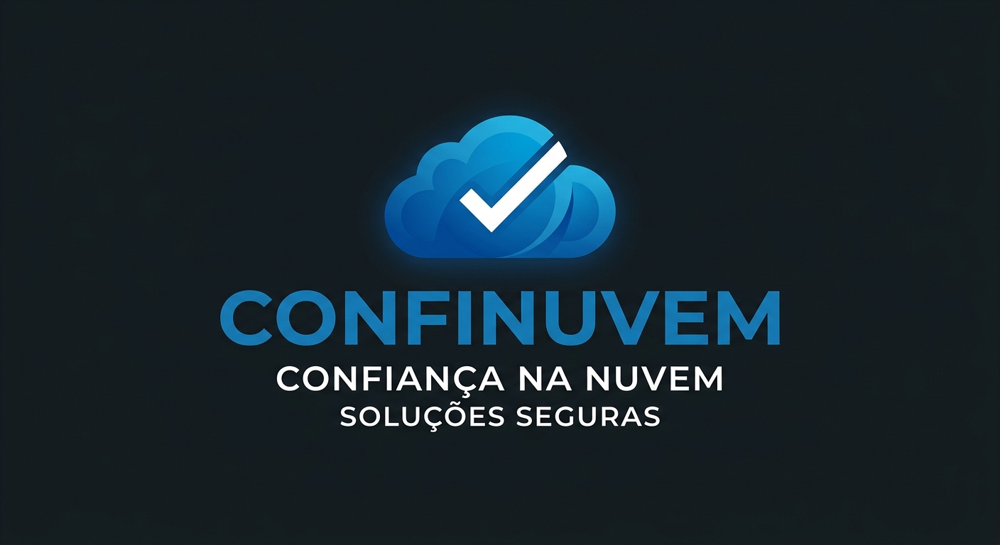

## Nome do projeto/empresa

ConfiNuvem

**Slogan:** Confiança na nuvem

**Equipe:** João Augusto Silva de Araújo, Miguel Rodrigo da Silva Normando, Pedro Henrique de Sousa Dantas Gomes e Wesley Trajano Cardoso do Carmo.

O plano de marketing (identidade visual, precificação, distribuição e promoção) está em [plano-de-marketing.md](plano-de-marketing.md).

## Missão, visão e competência essencial

**Missão:** Prestação de consultoria para empresas na migração de banco de dados físico para armazenamento em nuvem com segurança, confiabilidade e redundância. Consultoria para migração de documentos internos para soluções em nuvem.

**Visão:** Ser referência em migração segura e modernização de sistemas internos para nuvem, com abordagem integrada.

**Competência essencial:** Abordagem com ferramentas de segurança, suporte remoto pós-migração, capacitação de funcionários, processo simplificado e confiável na digitalização e modernização de sistemas internos da empresa.

## Análise do ambiente geral (3 aspectos macro + fonte ABNT)

Apresente aqui uma análise ambiental que aborde pelo menos **três** características macro ambientais (aspectos tecnológicos, político legais, culturais, etc) que influenciam direta ou indiretamente o negócio. **Atenção: Não esqueçam de inserir a fonte de pesquisa. Utilize o formato ABNT**

**Aspecto econômico:** o mercado brasileiro de computação em nuvem está em forte expansão, tendo movimentado R$ 85 bilhões em 2025 (alta de 35,5%), com a Brasscom projetando R$ 765,6 bilhões em aportes no setor entre 2026 e 2029 (BRASSCOM, 2026). O mercado brasileiro de TI como um todo atingiu US$ 67,8 bilhões em 2025, ante US$ 58,6 bilhões em 2024 (ASSOCIAÇÃO BRASILEIRA DAS EMPRESAS DE SOFTWARE, 2026). Esse cenário de expansão favorece a demanda por serviços de consultoria em migração para nuvem.

**Aspecto político-legal:** a Lei Geral de Proteção de Dados (Lei nº 13.709/2018) entrou em fase de fiscalização mais rigorosa: em fevereiro de 2026 a Lei nº 15.352/2026 transformou a Autoridade Nacional de Proteção de Dados (ANPD) em agência reguladora com poder de polícia administrativa, e em junho de 2026 a autoridade abriu 19 novos processos sancionadores de uma só vez (AUTORIDADE NACIONAL DE PROTEÇÃO DE DADOS, 2026). Em contrapartida, a Resolução CD/ANPD nº 2/2022 concede tratamento diferenciado a agentes de pequeno porte, dispensando-os, por exemplo, da obrigatoriedade de indicar encarregado de dados (AUTORIDADE NACIONAL DE PROTEÇÃO DE DADOS, 2022). Esse ambiente regulatório reforça a necessidade de empresas — sobretudo pequenas — adequarem o tratamento e a guarda de dados pessoais ao migrarem para a nuvem.

**Aspecto tecnológico/sociocultural:** parte significativa das micro, pequenas e médias empresas brasileiras ainda mantém processos pouco digitalizados: 39% delas (cerca de 7,5 milhões) realizam controles financeiros manuais, em planilhas dispersas ou em papel (CONTA SIMPLES; VISA, 2025 apud STARTUPS.COM.BR, 2025). Em contrapartida, pesquisa da Microsoft aponta que 93% das PMEs aceleraram sua digitalização desde a pandemia (MICROSOFT, 2025 apud STARTUPS.COM.BR, 2025). Esse contraste evidencia tanto a demanda represada por modernização quanto a urgência de segurança e redundância no tratamento de documentos ainda físicos.

## Clientes em potencial

Empresas pequenas que possuem bancos de dados físicos e documentos internos e desejam migrar para armazenamento em nuvem com foco em segurança e redundância.

## Concorrentes em potencial (tabela)

| Concorrente | Preço da migração | Capacitação incluída | Suporte pós-migração |
| --- | --- | --- | --- |
| NeonDB | Não há preço público separado para um serviço de migração. A plataforma tem plano Free a US$ 0/mês; os planos pagos seguem cobrança por uso. [[1]](https://neon.tech/pricing) | A documentação oferece métodos e guias de migração, mas não informa treinamento formal incluído. [[2]](https://neon.tech/migration-assistance) | O suporte varia por plano: comunidade no Free, suporte de cobrança no Launch e suporte Standard, Business ou Production no Scale. [[1]](https://neon.tech/pricing) |
| Supabase | Não há preço público separado para um serviço de migração. A plataforma oferece Free a US$0/mês, Pro a partir de US$ 25/mês e Team a partir de US$ 599/mês; computação é cobrada por projeto. [[3]](https://supabase.com/pricing) | A empresa disponibiliza guias para migrar de PostgreSQL, Neon, MySQL, MSSQL e outros, mas não indica treinamento formal nos planos comuns. [[4]](https://supabase.com/docs/guides/platform/migrating-to-supabase) | Free inclui suporte da comunidade; Pro inclui suporte por e-mail; Team inclui suporte prioritário e SLAs; Enterprise inclui gerente dedicado, suporte 24/7 e apoio de migração. [[3]](https://supabase.com/pricing) [[5]](https://supabase.com/solutions/enterprise) |

## Fornecedores (tabela)

| Fornecedor | Insumo/Serviço fornecido | Preço praticado | Localização |
| --- | --- | --- | --- |
| Acronis | Backup as a Service e proteção cibernética integrada (Cyber Protect) | A partir de US$ 85/ano por estação de trabalho | Virtual — acronis.com |
| Google Cloud Migration Center | Plataforma de planejamento e execução de migração para nuvem (inventário, dependências, TCO) | Gratuita (cobra-se apenas a infraestrutura de destino usada) | Virtual — cloud.google.com/migration-center |
| HashiCorp | Encriptação e gerenciamento de segredos (Vault) | A partir de US$ 450/mês (cluster dev) + US$ 72,92/cliente/mês | Virtual — hashicorp.com |

## Análise SWOT

**Forças:** Processo simplificado e confiável, abordagem com ferramentas de segurança, pacote completo (migração + capacitação + suporte), fidelização com descontos progressivos.

**Fraquezas:** Empresa nova, sem marca consolidada nem histórico de clientes no mercado; equipe enxuta, o que limita a capacidade de atender vários clientes simultaneamente nas fases iniciais; dependência de fornecedores terceirizados de tecnologia (Google, AWS, Veeam, Acronis, Thales, HashiCorp), com preços praticados majoritariamente em dólar e sujeitos a variação cambial; ausência de estrutura própria de suporte 24/7 no início da operação.

**Oportunidades:** Demanda por migração para nuvem, capacitação de equipes.

**Ameaças:** Concorrência de plataformas já consolidadas que empacotam migração, segurança e suporte em soluções prontas, como NeonDB e Supabase, além do risco de grandes provedores de nuvem (Google, AWS) passarem a oferecer migração assistida diretamente ao cliente final, dispensando o intermediário; ambiente regulatório mais rigoroso da LGPD, com a ANPD atuando como agência reguladora e ampliando a fiscalização, o que eleva o custo de conformidade da consultoria; ameaças de cibersegurança (ransomware, vazamento de dados) que podem gerar responsabilização contratual da empresa perante os clientes; instabilidade cambial que encarece o custo dos fornecedores internacionais contratados.

## Plano de ação 5W2H

Baseado no Protocolo de Migração e correções:

- **What (O quê):** Migração de bancos de dados físicos e documentos internos para nuvem (Google, AWS), com capacitação e suporte. Contrato com modalidade de pagamento definida e fluxo de receita único. Orçamento interno da empresa especificado. Remuneração via pró-labore.
- **Why (Por quê):** Segurança, confiabilidade, redundância e suporte pós-migração. Processo de assinatura claro para o serviço completo.
- **Where (Onde):** Servidores online com mecanismos de segurança e redundância.
- **When (Quando):** Conforme cronograma elaborado no planejamento.
- **Who (Quem):** Equipe de consultoria, fornecedores Google e AWS, funcionários internos (capacitação).
- **How (Como):**
    1. Avaliação do ambiente atual, requisitos de segurança e volume de dados.
    2. Planejamento: escolha de fornecedores, definição de ferramentas de segurança, elaboração de cronograma e orçamento interno.
    3. Execução: transferência de dados para servidores em nuvem com mecanismos de redundância. Implementação de soluções integradas.
    4. Capacitação: treina funcionários em boas práticas de segurança e uso das ferramentas.
    5. Suporte: oferece suporte remoto contínuo. Aplica descontos progressivos em manutenção conforme fidelização.
- **How much (Quanto):** Orçamento interno da empresa; fluxo de receita único; pró-labore. Custo fixo mensal estimado de R$ 8.307,24 (administrativas R$ 710,00; marketing R$ 400,00; pró-labore de 4 sócios a R$ 1.621,00 mais INSS de 11%, R$ 7.197,24), capacidade de 336 h produtivas por mês e preço da hora básica de R$ 52,46 (markup de 30%). Detalhes em [plano-de-marketing.md](plano-de-marketing.md).

## Referências bibliográficas

ACRONIS. *Acronis Cyber Protect*: purchasing. Disponível em: <https://acronis.com/ru-ru/business/backup/purchasing>. Acesso em: 21 set. 2026.

AMAZON WEB SERVICES. *AWS Database Migration Service*: pricing. Disponível em: <https://aws.amazon.com/dms/pricing/>. Acesso em: 21 set. 2026.

ASSOCIAÇÃO BRASILEIRA DAS EMPRESAS DE SOFTWARE (ABES). *Evolução e maturidade*: ABES revela novos dados do estudo Mercado Brasileiro de Software 2026. Disponível em: <https://abes.org.br/evolucao-e-maturidade-abes-revela-novos-dados-do-estudo-mercado-brasileiro-de-software-2026/>. Acesso em: 21 set. 2026.

AUTORIDADE NACIONAL DE PROTEÇÃO DE DADOS (ANPD). *Resolução CD/ANPD nº 2*, de 27 de janeiro de 2022. Aprova o regulamento de aplicação da Lei Geral de Proteção de Dados Pessoais (LGPD) para os agentes de tratamento de pequeno porte. Diário Oficial da União, Brasília, DF, 28 jan. 2022.

AUTORIDADE NACIONAL DE PROTEÇÃO DE DADOS (ANPD). Fiscalização e nova agenda regulatória em 2026. In: SECUREPRIVACY. *LGPD conformidade*: guia completo 2026. Disponível em: <https://secureprivacy.ai/pt/blog/lgpd-conformidade-guia-completo-2026>. Acesso em: 21 set. 2026.

CAPITAL ABERTO. Alibaba Cloud marca para julho início das operações no Brasil. Disponível em: <https://capitalaberto.com.br/negocios/alibaba-cloud-marca-para-julho-inicio-de-operacao-no-brasil/>. Acesso em: 21 set. 2026.

GOOGLE CLOUD. *Migration Center*: cloud migration planning and assessment. Disponível em: <https://cloud.google.com/migration-center>. Acesso em: 21 set. 2026.

HASHICORP. *Vault*: pricing. Disponível em: <https://www.hashicorp.com>. Acesso em: 21 set. 2026.

NEON. *Pricing*. Disponível em: <https://neon.tech/pricing>. Acesso em: 21 set. 2026.

STARTUPS.COM.BR. Menos dívida, mais estratégia: a revolução silenciosa das PMEs e startups brasileiras. Disponível em: <https://startups.com.br/artigo/menos-divida-mais-estrategia-a-revolucao-silenciosa-das-pmes-e-startups-brasileiras/>. Acesso em: 21 set. 2026.

SUPABASE. *Pricing*. Disponível em: <https://supabase.com/pricing>. Acesso em: 21 set. 2026.

THALES GROUP. *CipherTrust*: enterprise data encryption solutions. Disponível em: <https://cpl.thalesgroup.com/encryption>. Acesso em: 21 set. 2026.

VEEAM SOFTWARE. *Veeam pricing*. Disponível em: <https://www.veeam.com>. Acesso em: 21 set. 2026.
