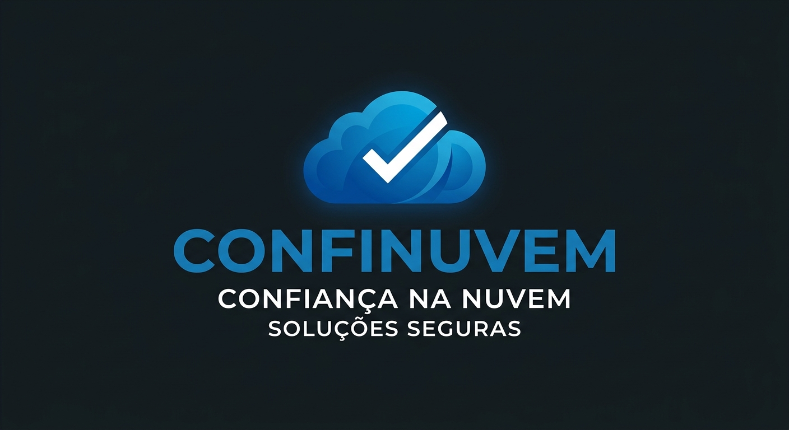

## Nome do projeto/empresa

ConfiNuvem

**Slogan:** Confiança na nuvem

**Equipe:** João Augusto Silva de Araújo, Miguel Rodrigo da Silva Normando, Pedro Henrique de Sousa Dantas Gomes e Wesley Trajano Cardoso do Carmo.

O plano de marketing (identidade visual, precificação, distribuição e promoção) está em [plano-de-marketing.md](plano-de-marketing.md).

## Missão, visão e competência essencial

**Missão:** Prestação de serviços especializados para migração e modernização de ambientes de TI para nuvem (Google Cloud, AWS), compreendendo: diagnóstico de ambiente, planejamento de migração, execução da migração de bancos de dados e documentos, capacitação de equipes e gestão contínua do ambiente cloud (Managed Services). Foco em segurança, conformidade LGPD, confiabilidade e parceria de longo prazo.

**Visão:** Ser referência em migração segura, modernização e gestão contínua de ambientes cloud para PMEs brasileiras, com portfólio modular, transparência em cada etapa e modelo de parceria recorrente.

**Competência essencial:** Portfólio modular de serviços cloud (diagnóstico, planejamento, migração, capacitação, gestão contínua) com abordagem integrada de segurança (backup Acronis, criptografia Vault, monitoramento), suporte remoto com SLA, capacitação com certificação, processo em 5 etapas com dependências explícitas e precificação transparente (hora de consultoria + planos mensais de gestão).

## Análise do ambiente geral (3 aspectos macro + fonte ABNT)

Apresente aqui uma análise ambiental que aborde pelo menos **três** características macro ambientais (aspectos tecnológicos, político legais, culturais, etc) que influenciam direta ou indiretamente o negócio. **Atenção: Não esqueçam de inserir a fonte de pesquisa. Utilize o formato ABNT**

**Aspecto econômico:** o mercado brasileiro de computação em nuvem está em forte expansão, tendo movimentado R$ 85 bilhões em 2025 (alta de 35,5%), com a Brasscom projetando R$ 765,6 bilhões em aportes no setor entre 2026 e 2029 (BRASSCOM, 2026). O mercado brasileiro de TI como um todo atingiu US$ 67,8 bilhões em 2025, ante US$ 58,6 bilhões em 2024 (ASSOCIAÇÃO BRASILEIRA DAS EMPRESAS DE SOFTWARE, 2026). Esse cenário de expansão favorece a demanda por serviços de consultoria em migração para nuvem.

**Aspecto político-legal:** a Lei Geral de Proteção de Dados (Lei nº 13.709/2018) entrou em fase de fiscalização mais rigorosa: em fevereiro de 2026 a Lei nº 15.352/2026 transformou a Autoridade Nacional de Proteção de Dados (ANPD) em agência reguladora com poder de polícia administrativa, e em junho de 2026 a autoridade abriu 19 novos processos sancionadores de uma só vez (AUTORIDADE NACIONAL DE PROTEÇÃO DE DADOS, 2026). Em contrapartida, a Resolução CD/ANPD nº 2/2022 concede tratamento diferenciado a agentes de pequeno porte, dispensando-os, por exemplo, da obrigatoriedade de indicar encarregado de dados (AUTORIDADE NACIONAL DE PROTEÇÃO DE DADOS, 2022). Esse ambiente regulatório reforça a necessidade de empresas — sobretudo pequenas — adequarem o tratamento e a guarda de dados pessoais ao migrarem para a nuvem.

**Aspecto tecnológico/sociocultural:** parte significativa das micro, pequenas e médias empresas brasileiras ainda mantém processos pouco digitalizados: 39% delas (cerca de 7,5 milhões) realizam controles financeiros manuais, em planilhas dispersas ou em papel (CONTA SIMPLES; VISA, 2025 apud STARTUPS.COM.BR, 2025). Em contrapartida, pesquisa da Microsoft aponta que 93% das PMEs aceleraram sua digitalização desde a pandemia (MICROSOFT, 2025 apud STARTUPS.COM.BR, 2025). Esse contraste evidencia tanto a demanda represada por modernização quanto a urgência de segurança e redundância no tratamento de documentos ainda físicos.

## Clientes em potencial

Empresas pequenas que possuem bancos de dados físicos e documentos internos e desejam migrar para armazenamento em nuvem com foco em segurança e redundância.

## Concorrentes em potencial (tabela comparativa por serviço)

| Serviço ConfiNuvem | NeonDB | Supabase | Diferencial ConfiNuvem |
| --- | --- | --- | --- |
| **1. Diagnóstico (Avaliação)** | Não oferece serviço separado; apenas documentação de autoavaliação | Não oferece serviço separado; apenas documentação | **Gratuito como lead**; relatório formal com mapa de riscos e estimativa |
| **2. Planejamento de Migração** | Guias técnicos genéricos; sem plano customizado por cliente | Guias de migração por origem (PostgreSQL, MySQL, etc.); sem TCO/rollback customizado | **Plano customizado** com arquitetura, cronograma Gantt, TCO, rollback, matriz de riscos |
| **3. Execução da Migração** | Ferramentas de importação (CLI/API); suporte apenas em planos Enterprise | Ferramentas de importação; apoio de migração apenas no plano Enterprise (US$ 599+/mês) | **Execução assistida por consultores**; validação, cutover planejado, checklist, credenciais documentadas |
| **4. Capacitação (Trilha)** | Documentação técnica; sem treinamento formal incluso | Documentação técnica; sem treinamento formal incluso | **Treinamento com certificado**, material didático (PDF/vídeo), sessões remoto/presencial, avulso ou no pacote |
| **5. Gestão Contínua (Managed Services)** | Plataforma gerenciada pelo cliente; suporte por plano (comunidade a Enterprise) | Plataforma gerenciada pelo cliente; suporte por plano (comunidade a Enterprise) | **ConfiNuvem Care**: backup gerido (Acronis), Vault gerido, monitoramento/SIEM, suporte N1/N2 com SLA, relatórios compliance LGPD — 3 faixas de preço (R$ 1.171 a R$ 4.429/mês) |

> **Resumo:** NeonDB e Supabase são **plataformas de banco de dados** (DBaaS) onde o cliente gerencia a migração e a operação. A ConfiNuvem é **consultoria + gestão especializada** que pode usar essas plataformas (ou Google/AWS) como infraestrutura, entregando serviço ponta a ponta com responsabilidade técnica e contratual.

## Fornecedores (tabela)

| Fornecedor | Insumo/Serviço fornecido | Preço praticado | Localização |
| --- | --- | --- | --- |
| Acronis | Backup as a Service e proteção cibernética integrada (Cyber Protect) | A partir de US$ 85/ano por estação de trabalho | Virtual — acronis.com |
| Google Cloud Migration Center | Plataforma de planejamento e execução de migração para nuvem (inventário, dependências, TCO) | Gratuita (cobra-se apenas a infraestrutura de destino usada) | Virtual — cloud.google.com/migration-center |
| HashiCorp | Encriptação e gerenciamento de segredos (Vault) | A partir de US$ 450/mês (cluster dev) + US$ 72,92/cliente/mês | Virtual — hashicorp.com |

## Análise SWOT

**Forças:** Portfólio modular (5 serviços individualizáveis + pacote integrado com desconto), abordagem com ferramentas de segurança (Acronis, Vault, monitoramento), processo em 5 etapas com dependências explícitas e entregáveis formais, capacitação com material didático e certificado, gestão contínua recorrente (ConfiNuvem Care) com 3 faixas de SLA, fidelização com descontos progressivos, precificação transparente (hora consultoria + MRR gestão).

**Fraquezas:** Empresa nova, sem marca consolidada nem histórico de clientes no mercado; equipe enxuta, o que limita a capacidade de atender vários clientes simultaneamente nas fases iniciais; dependência de fornecedores terceirizados de tecnologia (Google, AWS, Veeam, Acronis, Thales, HashiCorp), com preços praticados majoritariamente em dólar e sujeitos a variação cambial; ausência de estrutura própria de suporte 24/7 no início da operação.

**Oportunidades:** Demanda por migração para nuvem, capacitação de equipes, crescimento do mercado de Managed Services (MSP) para PMEs, adequação à LGPD/ANPD como serviço recorrente, upsell natural do diagnóstico gratuito para pacote completo e gestão contínua.

**Ameaças:** Concorrência de plataformas já consolidadas que empacotam migração, segurança e suporte em soluções prontas, como NeonDB e Supabase, além do risco de grandes provedores de nuvem (Google, AWS) passarem a oferecer migração assistida diretamente ao cliente final, dispensando o intermediário; ambiente regulatório mais rigoroso da LGPD, com a ANPD atuando como agência reguladora e ampliando a fiscalização, o que eleva o custo de conformidade da consultoria; ameaças de cibersegurança (ransomware, vazamento de dados) que podem gerar responsabilização contratual da empresa perante os clientes; instabilidade cambial que encarece o custo dos fornecedores internacionais contratados.

## Plano de ação 5W2H

Baseado no Protocolo de Migração e correções:

- **What (O quê):** Portfólio de serviços cloud: (1) Diagnóstico ConfiNuvem (avaliação), (2) Plano de Migração ConfiNuvem (planejamento), (3) Migração ConfiNuvem (execução), (4) Trilha ConfiNuvem (capacitação), (5) ConfiNuvem Care (gestão contínua/Managed Services mensal). Contratos por serviço avulso ou Pacote Integrado com desconto. Dois fluxos de receita: projetos de consultoria (hora R$ 52,46) e recorrência mensal (faixas R$ 1.171 a R$ 4.429). Orçamento interno especificado. Remuneração via pró-labore.
- **Why (Por quê):** Segurança, conformidade LGPD, confiabilidade, redundância e parceria contínua. Modelo modular permite ao cliente contratar apenas o necessário (ex.: só diagnóstico gratuito, ou só gestão contínua), com transparência de escopo, entregáveis e preço em cada etapa.
- **Where (Onde):** Servidores online com mecanismos de segurança e redundância.
- **When (Quando):** Conforme cronograma elaborado no planejamento.
- **Who (Quem):** Equipe de consultoria, fornecedores Google e AWS, funcionários internos (capacitação).
- **How (Como):**
    1. **Diagnóstico (Avaliação):** Análise de inventário, volumetria, riscos, LGPD, maturidade cloud. Entregável: relatório + mapa de riscos + estimativa. (Gratuito como lead, ou avulso).
  2. **Planejamento:** Arquitetura alvo, ferramentas, cronograma Gantt, TCO, rollback, matriz de riscos. Entregável: documento técnico + orçamento. (Requer Diagnóstico).
  3. **Execução (Migração):** Provisionamento, migração dados/bancos, validação, cutover, testes. Entregável: ambiente em produção + relatório + checklist. (Requer Planejamento).
  4. **Capacitação (Trilha ConfiNuvem):** Segurança, operação, boas práticas. Entregável: treinamento + material didático + certificado. (Opcional, recomendada pós-execução).
  5. **Gestão Contínua (ConfiNuvem Care):** Backup gerido, Vault gerido, monitoramento/SIEM, suporte N1/N2, manutenção, relatórios compliance. Modelo: mensal recorrente 3 faixas (Básico/Pro/Enterprise). (Independente, pode vir sem migração).
- **How much (Quanto):** Orçamento interno da empresa; **dois fluxos de receita**: (a) projetos de consultoria por hora (R$ 52,46/h, capacidade 336 h/mês) e (b) receita recorrente mensal MRR (ConfiNuvem Care, faixas R$ 1.171 a R$ 4.429/mês). Custo fixo mensal estimado de R$ 8.307,24 (administrativas R$ 710,00; marketing R$ 400,00; pró-labore de 4 sócios a R$ 1.621,00 mais INSS de 11%, R$ 7.197,24). Custos variáveis de projetos (infra temporária, licenças por cliente) e custos de gestão contínua (licenças Acronis/Vault, monitoramento, plantão) segregados por serviço. Detalhes em [plano-de-marketing.md](plano-de-marketing.md) (seções 3.3 e 3.6).

## Referências bibliográficas

ACRONIS. *Acronis Cyber Protect*: purchasing. Disponível em: <https://acronis.com/ru-ru/business/backup/purchasing>. Acesso em: 21 set. 2026.

AMAZON WEB SERVICES. *AWS Database Migration Service*: pricing. Disponível em: <https://aws.amazon.com/dms/pricing/>. Acesso em: 21 set. 2026.

ASSOCIAÇÃO BRASILEIRA DAS EMPRESAS DE SOFTWARE (ABES). *Evolução e maturidade*: ABES revela novos dados do estudo Mercado Brasileiro de Software 2026. Disponível em: <https://abes.org.br/evolucao-e-maturidade-abes-revela-novos-dados-do-estudo-mercado-brasileiro-de-software-2026/>. Acesso em: 21 set. 2026.

AUTORIDADE NACIONAL DE PROTEÇÃO DE DADOS (ANPD). *Resolução CD/ANPD nº 2*, de 27 de janeiro de 2022. Aprova o regulamento de aplicação da Lei Geral de Proteção de Dados Pessoais (LGPD) para os agentes de tratamento de pequeno porte. Diário Oficial da União, Brasília, DF, 28 jan. 2022.

AUTORIDADE NACIONAL DE PROTEÇÃO DE DADOS (ANPD). Fiscalização e nova agenda regulatória em 2026. In: SECUREPRIVACY. *LGPD conformidade*: guia completo 2026. Disponível em: <https://secureprivacy.ai/pt/blog/lgpd-conformidade-guia-completo-2026>. Acesso em: 21 set. 2026.

CAPITAL ABERTO. Alibaba Cloud marca para julho início das operações no Brasil. Disponível em: <https://capitalaberto.com.br/negocios/alibaba-cloud-marca-para-julho-inicio-de-operacao-no-brasil/>. Acesso em: 21 set. 2026.

GOOGLE CLOUD. *Migration Center*: cloud migration planning and assessment. Disponível em: <https://cloud.google.com/migration-center>. Acesso em: 21 set. 2026.

HASHICORP. *Vault*: pricing. Disponível em: <https://www.hashicorp.com>. Acesso em: 21 set. 2026.

NEON. *Pricing*. Disponível em: <https://neon.tech/pricing>. Acesso em: 21 set. 2026.

STARTUPS.COM.BR. Menos dívida, mais estratégia: a revolução silenciosa das PMEs e startups brasileiras. Disponível em: <https://startups.com.br/artigo/menos-divida-mais-estrategia-a-revolucao-silenciosa-das-pmes-e-startups-brasileiras/>. Acesso em: 21 set. 2026.

SUPABASE. *Pricing*. Disponível em: <https://supabase.com/pricing>. Acesso em: 21 set. 2026.

THALES GROUP. *CipherTrust*: enterprise data encryption solutions. Disponível em: <https://cpl.thalesgroup.com/encryption>. Acesso em: 21 set. 2026.

VEEAM SOFTWARE. *Veeam pricing*. Disponível em: <https://www.veeam.com>. Acesso em: 21 set. 2026.
